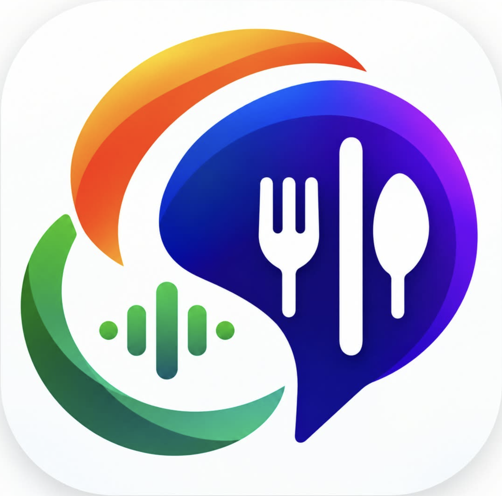
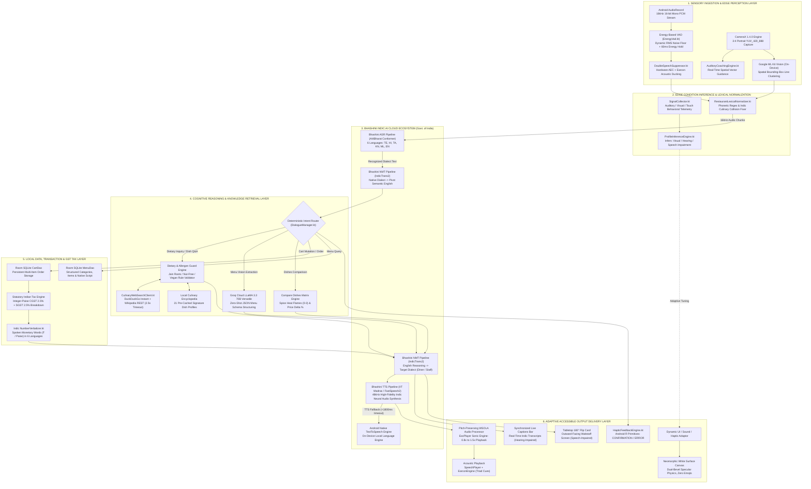
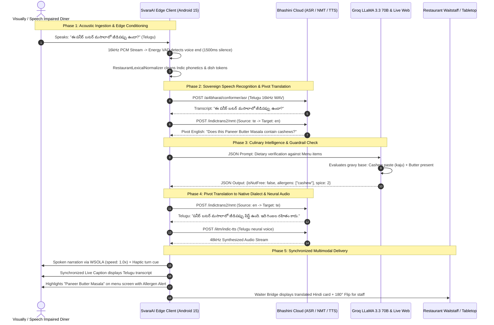

# SvaraAI (స్వర / स्वरा)
### Multimodal Accessible Dining Assistant for Bharat 🇮🇳
**Team OpenVino (Team ID: 65) — Megathon 2026**

[](https://kotlinlang.org)
[-green.svg)](https://developer.android.com)
[](https://developer.android.com/jetpack/compose)
[-orange.svg)](https://bhashini.gov.in)
[](https://groq.com)
[](LICENSE)

<p align="center">
  
</p>

---

## 📖 Executive Overview

**SvaraAI** is an AI-powered, multimodal, accessible dining companion engineered specifically for the complex linguistic, dietary, and physical landscape of Indian restaurants. 

In India, dining out presents formidable accessibility barriers:
- **Visually impaired diners** cannot read physical, laminated, or printed menus and must rely entirely on busy waiters or companions.
- **Hearing-impaired diners** cannot hear spoken specials or waiter responses in noisy restaurant environments.
- **Speech-impaired diners or non-native travelers** struggle with speech recognition or language barriers when communicating with restaurant staff who speak different regional languages.
- **Dietary strictness**: Strict religious, allergen, and cultural requirements (100% Vegetarian, Jain with strict exclusion of root vegetables, Nut allergies) require reliable ingredient transparency without cross-contamination.

**SvaraAI eliminates these barriers** by pairing **Government of India's Bhashini Indic AI ecosystem** (ASR, NMT, TTS) with **CameraX Spatial OCR**, **Groq LLaMA 3.3 70B reasoning**, **Live Culinary Knowledge Retrieval**, and a tactile **Neomorphic White Interface**.

---

## 🏛️ Accessible Conditions & Demonstrable Adaptations

Rather than relying on a generic accessibility switch, SvaraAI actively infers user needs from input modalities, acoustic cues, and direct interactions, delivering specific, demonstrable adaptations for each condition:

| Condition | Barrier in Dining | SvaraAI Demonstrable Adaptation |
| :--- | :--- | :--- |
| **Visual** *(Mandatory)* | Cannot see screens, printed menus, images, or prices | **Voice-first operation**: Real-time 16kHz PCM voice control, **Spatial Auditory Blind Framing Coach** (spoken camera orientation: *"Move higher"*, *"Tilt right"*, *"Menu centered"*), automatic screen-reader semantics, acoustic earcons, and continuous spoken menu recitation via **Bhashini TTS**. |
| **Hearing** | Cannot hear audio, spoken totals, or waiter replies in noisy dining halls | **Live Synchronized Captions & Transcripts**: Every spoken response is displayed simultaneously in live caption bars; **Tabletop 180° Flip Card** for visual waiter interaction; visual confirmation badges and haptic tactile alerts replacing audio cues. |
| **Speech** | Voice input not recognized or patron is non-verbal | **Visual Phraseboards & Tolerant Multi-Dialect ASR**: 1-tap instant category phraseboard for all dining intents; restaurant lexical normalizers for dialect tolerance; one-touch complaint chips that synthesize voice directly to staff via **Bhashini TTS**. |

> **System Inference**: The system observes user behavior (audio presence, caption usage, touch vs. voice) and dynamically prioritizes multimodal channels so every patron receives a tailored dining experience.

---

## 🏗️ Deep Technical System Architecture

SvaraAI operates on a multi-tier, hybrid edge-cloud distributed architecture combining real-time on-device sensory processing with sovereign Indian AI cloud pipelines:



---

## 🔄 The End-to-End Speech-to-Speech & Vision Execution Pipeline



### Core Pipeline Capabilities:
1. **True Speech-to-Speech in 6 Indic Languages**: Speak in one Indian language (Telugu, Hindi, Tamil, Kannada, Malayalam, or English) and hear the answer in your native language or translated for the waiter.
2. **Accessible Outputs**: Real accessible headings, tables and prices described in natural words, synchronized live captions, and pitch-preserving speech speed controls (0.8x to 1.5x).
3. **Graceful Failure & Network Resilience**: Misrecognized speech or network timeouts prompt polite clarification requests (*"Could you please repeat that?"*), backed by instant on-device offline fallback encyclopedias and Android native TTS.
4. **Zero Proprietary Hardware**: Runs on standard consumer Android phones (API 26+) with standard microphone and camera hardware.

---

## 🍽️ The 6 Core Dining Features (Detailed Breakdown)

---

### 1. Photograph the Menu and Hear Each Dish Read Aloud
*Empowering blind, low-vision, and illiterate diners to explore printed paper menus independently.*

```
Camera Viewfinder (3:4 Portrait) ──▶ Auditory Coaching ──▶ Dual OCR ──▶ Groq LLaMA Structuring ──▶ Bhashini TTS Narration
```

#### How It Works:
1. **Camera Framing & Auditory Coaching**:
   - The diner points their camera at any paper or laminated menu using the 3:4 portrait vertical viewfinder.
   - For blind patrons who cannot see the screen, SvaraAI's **Spatial Auditory Framing Coach** provides real-time spoken guidance:
     - *"Hold phone 8 inches above table."*
     - *"Camera tilted too far left, align vertically."*
     - *"Menu in full view, holding steady for capture."*
2. **Dual-Engine OCR Processing**:
   - Combines on-device Google ML Kit Text Recognition with spatial line clustering to preserve multi-column restaurant menus without text overlap.
3. **Groq LLaMA 3.3 70B Menu Structuring**:
   - Raw OCR text is parsed into structured JSON sections (Starters, Main Course, Breads, Desserts, Beverages), individual dish names, prices in integer Paise, and dietary classification.
4. **Bhashini TTS Narration**:
   - As the menu loads, SvaraAI immediately begins reading out each section and dish aloud in the diner's selected mother tongue (Telugu, Hindi, Tamil, Kannada, Malayalam, or English) using **IIT Madras Indic-TTS** / **FastSpeech2**.
   - Diners can pause, resume, replay, or skip sections using voice commands or the stop button.
5. **Sequential Post-Scan Prompts**:
   - **First 3 Seconds**: A bottom popup card displays `"Ready to Order"` with a one-tap shortcut to the cart.
   - **Next 2 Seconds**: Automatically transitions to `"Compare Dishes"` (*"Compare dishes by spice level and price, then order"*), providing an intuitive gateway into dish comparison.

---

### 2. Ask: "Is This Vegetarian, Jain or Nut-Free?"
*Comprehensive dietary and allergen protection powered by AI culinary reasoning and live web search.*

```
Voice Query in Mother Tongue ──▶ Bhashini ASR ──▶ Bhashini NMT ──▶ Dietary Guardrail Reasoner ──▶ Bhashini TTS Spoken Answer
```

#### How It Works:
1. **Spoken Dietary Inquiry**:
   - Diners tap the microphone or speak naturally in any of the 6 languages:
     - *"Ask: is this vegetarian, Jain or nut-free?"*
     - *"Is paneer butter masala Jain or does it contain root vegetables?"*
     - *"Does dal makhani have nuts or cashew paste?"*
     - *"ఈ వంటకంలో జీడిపప్పు లేదా ఉల్లిపాయలు ఉన్నాయా?"* (Telugu)
     - *"क्या इस दाल में लहसुन या प्याज है?"* (Hindi)
2. **Bhashini ASR & NMT Pipeline**:
   - Transcribes regional voice input with **AI4Bharat Conformer ASR** and translates it into culinary semantic tokens using **Bhashini IndicTrans2 NMT**.
3. **Ingredient Verification & Dietary Evaluation**:
   - **Vegetarian**: 100% plant and dairy-based; verifies absence of meat, fish, poultry, egg, and animal rennet.
   - **Jain Compliance**: Strict vegetarian check that verifies the complete absence of underground root vegetables (onions, garlic, potatoes, carrots, radishes, mushrooms).
   - **Nut & Allergen Safety**: Scrutinizes gravy bases for hidden cashew paste (*kaju paste*), almond (*badam*), peanut (*singdana/groundnut*), pistachio, and sesame.
4. **Bhashini TTS & Synchronized Display**:
   - Generates a spoken answer in the diner's language detailing whether the dish complies with their dietary restrictions and what substitutes are available.
   - Automatically scrolls the menu browser to the queried item and highlights it on screen (`HIGHLIGHT_ITEM`) with an emerald green or amber dietary badge.

---

### 3. Explain Unfamiliar Dishes and Ingredients Simply
*Translating complex regional culinary terminology into plain, easy-to-understand explanations.*

```
"What is Chilli Chicken?" ──▶ Bhashini ASR ──▶ Live Culinary Web Search + Local Encyclopedia ──▶ Plain Explanation via TTS
```

#### How It Works:
1. **Natural Culinary Inquiries**:
   - Indian menus feature hyper-regional dishes that travelers or non-locals may not recognize (e.g., *Chilli Chicken*, *Chicken 65*, *Rasam*, *Mutton Rogan Josh*, *Bisi Bele Bath*, *Pesarattu*).
   - Diners can ask: *"What is chilli chicken?"*, *"How is biryani prepared?"*, or *"Tell me about rasam"*.
2. **Multi-Tier Live Knowledge Retrieval**:
   - **Groq LLaMA 3.3 70B Specialized Culinary Prompt**: Explains origin, cooking technique, flavor profile, and texture.
   - **Live Free Web Knowledge Retriever (`CulinaryWebSearchClient`)**: Queries DuckDuckGo Instant Answers & Wikipedia REST API with a strict 2.5-second timeout to retrieve definitions for rare or regional specialties.
   - **Local Offline Culinary Encyclopedia**: Pre-cached knowledge base covering 20+ signature North Indian, South Indian, and Indo-Chinese dishes for instantaneous offline answers.
3. **Plain Language Spoken Breakdown**:
   - Example Explanation for *Chilli Chicken*:
     > *"Chilli Chicken is a popular Indo-Chinese dish made with crispy batter-fried boneless chicken tossed with green chilies, garlic, soy sauce, and diced bell peppers. It has a spicy, savory, and tangy flavor profile. It is non-vegetarian, dairy-free, nut-free, and has a spice rating of 2 out of 3."*
4. **Strict Food-Only Guardrails**:
   - Non-food questions (e.g., politics, coding, mathematics, general trivia) are politely declined and redirected back to dining assistance across all 6 languages:
     - **English**: *"I am Svara, your restaurant assistant. I can only assist with food, dishes, ingredients, and your menu orders."*
     - **Telugu**: *"నేను స్వర, మీ రెస్టారెంట్ అసిస్టెంట్. నేను ఆహారం, వంటకాలు, పదార్థాలు మరియు మెనూ ఆర్డర్‌ల గురించిన ప్రశ్నలకు మాత్రమే సమాధానం ఇవ్వగలను."*
     - **Hindi**: *"मैं स्वरा हूँ, आपकी रेस्तरां सहायक। मैं केवल भोजन, व्यंजनों, सामग्री और मेनू से संबंधित सवालों के जवाब दे सकती हूँ।"*

---

### 4. Compare Dishes by Spice Level and Price, Then Order
*Side-by-side comparative matrix helping diners balance heat preferences and budget before placing orders.*

```
Compare Tab ──▶ Dual Dish Selectors ──▶ Delta Matrix (₹ Difference + Spice Flames) ──▶ 1-Tap Room DB Ordering
```

#### How It Works:
1. **Dedicated Comparison Section**:
   - Accessible from the bottom navigation bar or the 2-second post-scan popup.
   - Tagline: *"Compare dishes by spice level and price, then order"*.
2. **Side-by-Side Dual Dish Comparison Mode**:
   - Diners select **Dish A** and **Dish B** from dropdowns or quick-pick chips.
   - SvaraAI generates an immediate comparative summary:
     - **Price Delta**: Visual difference in Rupees and percentages (e.g., *"Dish A is ₹150 (62%) cheaper than Dish B"*).
     - **Spice Flame Meter**: 0 to 3 flame indicator (0 = Mild, 1 = Gentle Warmth, 2 = Medium Spicy, 3 = Very Spicy).
     - **Dietary Alignment**: Veg vs. Non-Veg, Jain compatibility, and nut-free safety.
     - **Flavor & Portions**: Preparation style, gravy consistency, and value recommendation.
3. **Comprehensive Filter & Sorting**:
   - **Dietary Filter**: *All*, *Veg*, *Non-Veg*, *Jain*, *Nut-Free*.
   - **Spice Filter**: *All*, *Mild (0–1)*, *Medium (2)*, *Spicy (3)*.
   - **Price Sort**: *Price: Low to High*, *Price: High to Low*.
4. **Scanned Menu & Preloaded Sample Menu Fallback**:
   - Dynamically loads dishes from the scanned physical menu.
   - If no menu has been scanned yet, preloads an authentic 8-dish sample menu (*Masala Dosa ₹90, Paneer Butter Masala ₹220, Chilli Chicken ₹240, Hyderabadi Dum Biryani ₹260, Dal Makhani ₹180, Veg Hakka Noodles ₹150, Fish Fry ₹280, Filter Coffee ₹40*).
5. **Direct 1-Tap Ordering**:
   - Each compared dish features a Neomorphic "Add to Cart / Order" button with animated checkmark, Room SQLite persistence, haptic vibration, and acoustic confirmation earcon.

---

### 5. Call the Waiter, Ask for the Bill, Split Payment
*Eliminating cross-language barriers between diners and restaurant staff with real-time translation and smart financial breakdown.*

```
Diner Speaks (Telugu/Tamil) ──▶ Bhashini NMT ──▶ Bhashini TTS (Hindi/English to Staff) ──▶ Waiter Replies ──▶ Translated Live Captions
```

#### How It Works:
1. **The Multilingual Waiter Bridge**:
   - **Sticky Dual-Microphone Action Bar**:
     - **"Speak to Waiter" (Diner Mic)**: Prominently docked below the language selector with animated soundwave bars; never scrolls off-screen.
     - **"Waiter Response" (Staff Mic)**: Allows waitstaff to speak in their native tongue; instantly translates back into diner captions.
   - **Tabletop 180° Flip Card**: Inverts typography and controls 180 degrees so the phone can be placed flat on the table facing the waiter.
   - **Quick Phraseboard**: Instant 1-tap category chips for essential dining requests (*"Bring Water"*, *"Get Menu"*, *"Call Captain"*, *"Need Extra Spoon/Plate"*, *"Pack Remaining Food"*).
2. **Voice Ordering Cart & Statutory Tax Engine**:
   - Voice-driven cart: say *"Add two Butter Naan and one Dal Tadka"* — SvaraAI parses items and quantities into the cart.
   - **Statutory Indian Tax Breakdown**: Computes statutory CGST (2.5%) and SGST (2.5%) in integer-paise precision to prevent rounding errors.
   - **Indic Number Verbalizer**: Bhashini TTS verbalizes exact monetary totals in spoken words across all 6 languages (e.g. Telugu *"ఐదు వందల అరవై రూపాయలు"*).
3. **Smart Bill Splitter**:
   - **Equal Split Mode**: Diners select guest count with `+` and `-` steppers; SvaraAI computes per-person share and announces it aloud.
   - **By-Item Split Mode**: Allocates specific dishes to individual diners, computing custom shares including proportional taxes.
   - **Spoken Breakdown**: Reads out each diner's exact share in Rupees and Paise.

---

### 6. Give Spoken Feedback or a Complaint to Staff
*Dignified, voice-activated issue escalation translating customer feedback into staff language.*

```
Speak Complaint in Any Language ──▶ Bhashini ASR ──▶ Bhashini NMT ──▶ Bhashini TTS Spoken to Waiter + Status Confirmation
```

#### How It Works:
1. **Raise Complaint or Feedback Section**:
   - Located at the bottom of the Waiter Bridge page in a dedicated Neomorphic Card.
   - Allows patrons to express feedback or escalate critical dining issues without embarrassment or confrontation.
2. **Voice Input in Any Language**:
   - The diner taps the feedback microphone and speaks naturally in English, Telugu, Hindi, Tamil, Kannada, or Malayalam:
     - *"The soup is cold, please heat it up."*
     - *"We have been waiting 30 minutes for our starter, please check."*
     - *"This dish is too spicy for the children."*
     - *"The biryani was delicious, compliment the chef!"*
3. **Instant Translation & Spoken Playback via Bhashini TTS**:
   - Transcribes speech via **Bhashini ASR**, translates into the staff's selected language via **Bhashini NMT**, and speaks aloud to the waiter/captain via **Bhashini TTS**.
4. **6 Instant One-Tap Category Chips**:
   - For speech-impaired patrons or rapid escalation, 6 pre-configured chips are available:
     1. *"Food is Cold / Reheat"*
     2. *"Delay in Order / Follow Up"*
     3. *"Missing Item from Order"*
     4. *"Too Spicy / Less Spice"*
     5. *"Clean Table / Cutlery Request"*
     6. *"Compliment Chef / Food is Delicious"*
5. **Manager Status Confirmation**:
   - Displays a confirmation card with status badge: `"Raised to Floor Manager / Captain"` along with the customer statement in their native language and the translated staff text.

---

## 🌐 Complete Bhashini Integration Matrix

SvaraAI utilizes official Bhashini endpoints across all 6 supported languages:

| Language | Code | Native Name | Bhashini ASR Pipeline | Bhashini NMT Pipeline | Bhashini TTS Pipeline |
| :--- | :--- | :--- | :--- | :--- | :--- |
| **Telugu** | `te` | **తెలుగు** | AI4Bharat Conformer Telugu | IndicTrans2 (te ↔ en / te ↔ hi) | IIT Madras Indic-TTS Telugu |
| **Hindi** | `hi` | **हिन्दी** | AI4Bharat Conformer Hindi | IndicTrans2 (hi ↔ en / hi ↔ te) | IIT Madras Indic-TTS Hindi |
| **Tamil** | `ta` | **தமிழ்** | AI4Bharat Conformer Tamil | IndicTrans2 (ta ↔ en / ta ↔ hi) | IIT Madras Indic-TTS Tamil |
| **Kannada** | `kn` | **ಕನ್ನಡ** | AI4Bharat Conformer Kannada | IndicTrans2 (kn ↔ en / kn ↔ hi) | IIT Madras Indic-TTS Kannada |
| **Malayalam** | `ml` | **മലയാളം** | AI4Bharat Conformer Malayalam | IndicTrans2 (ml ↔ en / ml ↔ hi) | IIT Madras Indic-TTS Malayalam |
| **English** | `en` | **English** | AI4Bharat Conformer English | IndicTrans2 (en ↔ Indic) | FastSpeech2 Neural English |

---

## 🎨 Neomorphic White Design System

- **Pure White / Slate Palette**: Clean, modern off-white background (`#F0F4F8`) with Royal Cobalt Blue accents (`#2563EB`) and high-contrast Slate typography (`#0F172A`).
- **Tactile Physics**: Dual-bevel light and shadow specular elevations create physical, embossed surfaces that resemble tangible hardware controls.
- **Strictly Zero Emojis**: 100% vector Material Icons for maximum screen-reader accessibility and professional aesthetic.
- **Dynamic Animations**: Pulse ripples on active microphones, animated waveform bars, and smooth transitions across tabs and popups.

---

## 📱 How to Run & Build

### Prerequisites
- **Android Studio Ladybug (2024.2+)** or newer.
- **JDK 17** or **JDK 21** (`JAVA_HOME` configured).
- Physical Android device running **Android 8.0 (API 26)** or higher with Microphone and Camera permissions.

### Build via Terminal
```bash
# Clone the repository
git clone https://github.com/IIIT-ECell/megathon26-openvino.git
cd SvaraAI

# Run all 101 automated unit tests (100% passing)
./gradlew testDebugUnitTest

# Assemble the Debug APK
./gradlew assembleDebug

# Install directly to connected device
adb install -r app/build/outputs/apk/debug/app-debug.apk
```

---

## 👥 Team & Acknowledgments

**Team OpenVino (Team ID: 65)**
- Developed for **Megathon 2026** under the Accessible AI track.
- Powered by the **Bhashini Open APIs** initiative by the Ministry of Electronics and Information Technology (MeitY), Government of India.

---

## 📄 License

This project is licensed under the **MIT License** — see the [LICENSE](LICENSE) file for details.
