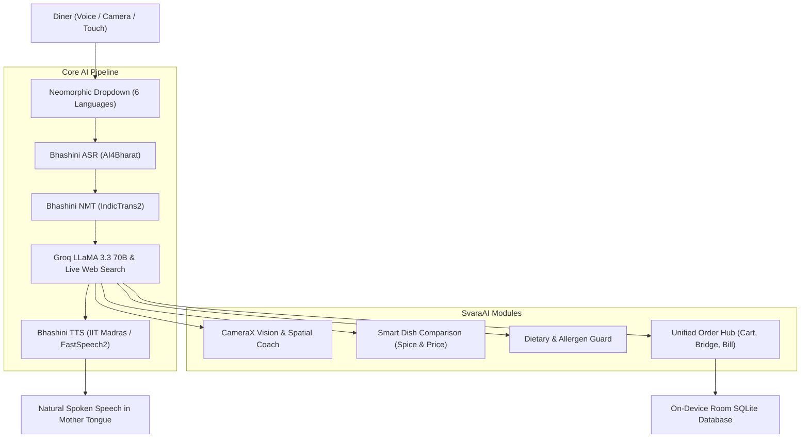

# SvaraAI (స్వర / स्वरा)
### Multimodal Accessible Dining Assistant for Bharat 🇮🇳
**Team OpenVino (Team ID: 65) — Megathon 2026**

[](https://kotlinlang.org)
[-green.svg)](https://developer.android.com)
[](https://developer.android.com/jetpack/compose)
[-orange.svg)](https://bhashini.gov.in)
[](https://groq.com)
[](LICENSE)

<p align="center">
  
</p>

---

## 📖 Executive Overview

**SvaraAI** is an AI-powered, multimodal, accessible dining companion built specifically for the diverse linguistic and physical landscape of Indian restaurants. 

In India, dining out presents formidable accessibility challenges:
- **Visually Impaired Diners** cannot read physical, laminated, or printed menus and must rely on busy waiters or dining companions.
- **Elderly Diners** struggle with low-contrast, small typography, rapid speech, and complex billing.
- **Linguistic Divide**: Travelers and diners often speak regional languages (e.g., Telugu, Tamil, Kannada, Malayalam) while restaurant waitstaff frequently speak Hindi or English, resulting in frequent order misunderstandings.
- **Dietary Strictness**: Strict dietary requirements (Vegetarian, Jain with no root vegetables, Nut allergies) are critical in India, where accidental cross-contamination or hidden cashew gravies pose serious health and cultural concerns.

**SvaraAI solves all of these challenges** through a combination of **Government of India's Bhashini Indic AI**, **Computer Vision**, **Groq LLaMA 3.3 70B reasoning**, **Live Culinary Knowledge Retrieval**, and a tactile **Neomorphic White Interface**.

---

## 🌟 Key Highlights & Innovations



---

## 🚀 End-to-End Feature Walkthrough

### 1. First-Time Launch Onboarding (9 Tactile Sliding Cards)
When launched for the first time, SvaraAI greets users with an interactive, animated Neomorphic carousel of 9 sliding cards:
- **Card 1: Voice-First Restaurant Assistant** — Hands-free dining assistance for visually impaired, elderly, and all diners.
- **Card 2: Bhashini Multi-Indic ASR & TTS** — Voice recognition and natural speech across 6 Indian languages.
- **Card 3: CameraX Menu Vision Scanner** — AI spatial OCR instantly digitizes physical menus into structured dishes and prices.
- **Card 4: Smart Dish Comparison Matrix** — Compare dishes side-by-side by spice level, price, and dietary attributes.
- **Card 5: Dietary & Allergen Safety Guard** — Instant vegetarian, Jain, nut-free ingredient checks and culinary Q&A.
- **Card 6: Voice Ordering Cart & Tax Engine** — Speak naturally to add items and compute real-time statutory CGST & SGST breakdowns.
- **Card 7: Multilingual Waiter Bridge** — Cross-language communication between diner and staff with instant TTS.
- **Card 8: Instant Staff Feedback & Escalation** — Voice-activated feedback or complaint escalation directly to the floor manager/captain.
- **Card 9: Smart Bill Splitter** — Equal split and item-wise share calculation with spoken verbalization.

*Once completed or skipped, SvaraAI automatically requests necessary runtime permissions (Microphone and Camera) and opens the main dashboard.*

---

### 2. High-End Bhashini Indic AI Integration 🇮🇳
SvaraAI integrates the **Bhashini ecosystem** across the entire dining journey to support **6 Indian languages**:
1. **Telugu (`te`, తెలుగు)** — *Default*
2. **Hindi (`hi`, हिन्दी)**
3. **Tamil (`ta`, தமிழ்)**
4. **Kannada (`kn`, ಕನ್ನಡ)**
5. **Malayalam (`ml`, മലയാളം)**
6. **English (`en`, English)**

#### How Bhashini AI Powers SvaraAI:
- **Neomorphic Dropdown Language Switcher**: Located on the top bar, allowing diners to instantly toggle their preferred language among all 6 Indic languages in authentic native script.
- **Bhashini ASR (Automated Speech Recognition)**:
  - Powered by **AI4Bharat Conformer** models trained on real Indian accents and speech patterns.
  - Converts spoken queries into accurate text with sub-second latency.
- **Bhashini NMT (Neural Machine Translation)**:
  - Powered by **IndicTrans2** models.
  - Translates seamlessly between any of the 6 diner languages and waitstaff languages in both directions.
- **Bhashini TTS (Text-to-Speech)**:
  - Integrated with **IIT Madras Indic-TTS** and **FastSpeech2 48kHz** neural voice engines.
  - Generates natural, soothing, and culturally authentic speech for menu reading, bill breakdowns, and waiter translations.
  - Built-in local Android native TTS fallback ensures zero interruption even during intermittent connectivity.
- **Restaurant Lexical Normalizer**:
  - Eliminates culinary dialect errors (e.g., prevents generic translators from mistranslating Telugu *"దోశలు"* as *"faults/mistakes"* instead of the dish *"Dosas"*).
- **Indic Number & Currency Verbalizer**:
  - Automatically speaks Rupee figures in natural phrasing across all 6 languages (e.g., Telugu *"రెండు వందల యాభై రూపాయలు"*, Hindi *"दो सौ पचास रुपये"*, Tamil *"இருநூற்று ஐம்பது ரூபாய்"*, Kannada *"ಇನ್ನೂರ ಐವತ್ತು ರೂಪಾಯಿ"*, Malayalam *"ഇരുന്നൂറ്റി അൻപത് രൂപ"*).

---

### 3. CameraX Menu Vision Scanner & Spatial OCR
Digitizes multi-page printed or laminated paper menus into accessible, interactive digital menus:
- **3:4 Portrait Vertical Viewfinder**: Designed with strict boundary containment so the camera feed never bleeds or distorts.
- **Dual-Engine OCR**: Combines fast on-device Google ML Kit Text Recognition with cloud OCR fallback.
- **Spatial Auditory Blind Framing Coach**:
  - Real-time spoken guidance guides visually impaired diners to position the camera accurately:
    - *"Move camera slightly higher"*
    - *"Tilt phone slightly right"*
    - *"Menu page perfectly centered, hold steady"*
- **Groq LLaMA 3.3 70B Menu Structuring**:
  - Parses noisy OCR text into structured restaurant sections, dishes, Indic transliterations, prices in Paise, and dietary tags.
- **Sequential Post-Scan Prompts**:
  - **First 3 Seconds**: Displays a bottom popup card: `"Ready to Order"` with quick shortcut to view cart.
  - **Next 2 Seconds**: Transitions to a bottom popup: `"Compare Dishes"` with tagline *"Compare dishes by spice level and price, then order"*, providing a direct gateway into the Compare section.

---

### 4. Smart Dish Comparison Engine
**Tagline**: *"Compare dishes by spice level and price, then order"*

A dedicated section accessible directly from the bottom navigation bar and menu scan prompts:
- **Side-by-Side Dual Dish Comparison**:
  - Select any **Dish A** and **Dish B** to see an immediate side-by-side comparison:
    - **Price Difference**: Visual delta (e.g., *"₹150 (62%) cheaper"*).
    - **Spice Heat Meter**: 0 to 3 flame rating (Mild, Medium, Spicy, Very Spicy).
    - **Dietary Class**: Veg / Non-Veg, Jain-friendly status, Nut-free safety.
    - **Flavor Profile & Ingredients**: Description and culinary origin.
- **Interactive Filtering & Sorting**:
  - Filter by Dietary: *All*, *Veg*, *Non-Veg*, *Jain*, *Nut-Free*.
  - Filter by Spice: *All*, *Mild (0–1)*, *Medium (2)*, *Spicy (3)*.
  - Sort by Price: *Price Low to High*, *Price High to Low*.
- **Preloaded Indic Sample Menu**:
  - If a menu has been scanned, SvaraAI compares the scanned restaurant items.
  - If no menu is scanned yet, SvaraAI preloads an authentic 8-dish sample menu (*Masala Dosa ₹90, Paneer Butter Masala ₹220, Chilli Chicken ₹240, Hyderabadi Dum Biryani ₹260, Dal Makhani ₹180, Veg Hakka Noodles ₹150, Fish Fry ₹280, Filter Coffee ₹40*).
- **Direct Ordering**: One-tap "Add to Cart" button with instant haptic confirmation and Room database persistence.

---

### 5. Dietary & Allergen Safety Guard with Live Culinary Search
Answers critical ingredient and culinary questions in natural spoken language:
- **Spoken Culinary Q&A**:
  - Diners can ask:
    - *"Is paneer butter masala Jain or does it have nuts?"*
    - *"What is chilli chicken?"*
    - *"How is chicken biryani prepared?"*
    - *"Is dal makhani dairy-free?"*
- **Multi-Tier Culinary Intelligence**:
  - **Groq LLaMA 3.3 70B** culinary reasoning prompt specialized in Indian food preparation.
  - **Live Free Web Knowledge Retriever**: Integrated DuckDuckGo Instant Answers & Wikipedia REST API (with a 2.5s strict timeout) to fetch live culinary origins and recipes for rare dishes.
  - **Offline Local Culinary Encyclopedia**: Pre-cached knowledge for 20+ signature North Indian, South Indian, and Indo-Chinese specialties.
- **Strict Food-Only Guardrails**:
  - Non-food questions (e.g., politics, coding, math, general trivia) are politely declined and redirected back to dining assistance in all 6 languages.
- **UI Synchronized Feedback**:
  - Dynamically highlights queried items on screen (`ANSWER_DIETARY`), auto-scrolls to the section, updates live captions, and speaks the answer aloud.

---

### 6. Unified Order & Service Hub
Consolidates Cart, Waiter Bridge, and Bill into a unified, clean navigation tab:

```
[ Voice Cart ]  |  [ Waiter Bridge ]  |  [ Bill & Split ]
```

#### Module A: Voice Ordering Cart & Tax Engine
- **Natural Voice Ordering**: Say *"Add two masala dosas and one filter coffee"* — SvaraAI parses items and quantities into the cart.
- **Statutory Indian Tax Breakdown**: Computes statutory CGST (2.5%) and SGST (2.5%) in integer-paise precision to prevent rounding errors.
- **Spoken Cart Summary**: Verbalizes total cost and tax breakdown using the Indic Number Verbalizer.

#### Module B: Multilingual Waiter Bridge
- **Sticky Dual-Microphone Action Bar**:
  - **"Speak to Waiter" (Diner Mic)**: Prominently fixed below the language selector with animated acoustic soundwave bars; never scrolls off-screen.
  - **"Waiter Response" (Staff Mic)**: Allows staff to speak in their native tongue; translates instantly into diner captions.
- **Tabletop Flip Card**: Flips the card 180° for easy tabletop reading by waitstaff.
- **Raise Complaint & Feedback System (Bottom of Bridge)**:
  - Voice-activated feedback or complaint escalation directly to the floor manager/captain.
  - **6 Instant Category Chips**:
    - *"Food is Cold / Reheat"*
    - *"Delay in Order / Follow Up"*
    - *"Missing Item from Order"*
    - *"Too Spicy / Less Spice"*
    - *"Clean Table / Cutlery Request"*
    - *"Compliment Chef / Food is Delicious"*
  - Translates into staff language and speaks aloud via TTS, displaying status badge *"Raised to Floor Manager / Captain"*.

#### Module C: Smart Bill Splitter
- **Equal Split vs Itemized Split**: Easily split group dining bills by number of diners or by individual item claims.
- **Spoken Breakdown**: Reads out each diner's exact share in Rupees and Paise.

---

## 🎨 Neomorphic White Design Philosophy

SvaraAI is built with a custom **Neomorphic White Design System**:
- **Tactile Depth**: Dual-bevel light and shadow specular reflections create a soft, embossed, physical look.
- **Clean Palette**: Off-white surface (`#F0F4F8`), Royal Cobalt Blue primary accent (`#2563EB`), and Slate typography (`#0F172A`).
- **Zero Emojis**: 100% vector Material Icons for maximum semantic clarity and screen-reader accessibility.
- **Smooth Animations**: Pulse ripples on active microphones, animated waveform bars, and smooth pager transitions.

---

## 🛠️ Architecture & Tech Stack

| Component | Technology | Role |
| :--- | :--- | :--- |
| **Language & Runtime** | Kotlin 2.0.21, Android SDK 35 (Android 15) | Core application platform |
| **UI Framework** | Jetpack Compose, Material 3, Neomorphic Surface Engine | Reactive accessible user interface |
| **Local Database** | Room SQLite 2.6.1 | Persistent storage for menus, carts, orders |
| **Speech Recognition** | **Bhashini ASR (AI4Bharat Conformer)** | Real-time Indian speech-to-text (6 languages) |
| **Machine Translation**| **Bhashini NMT (IndicTrans2)** | Bidirectional translation between diner & staff |
| **Speech Synthesis**   | **Bhashini TTS (IIT Madras / FastSpeech2)** | Neural Indic voice narration |
| **Reasoning Engine**   | **Groq Cloud (LLaMA 3.3 70B Versatile)** | Structured menu parsing, culinary Q&A |
| **Live Knowledge**     | DuckDuckGo Instant Answers & Wikipedia REST API | Live food knowledge retrieval (2.5s timeout) |
| **Computer Vision**    | CameraX 1.4.0 + Google ML Kit Text Recognition | Menu camera capture & OCR processing |
| **Audio Processing**   | Android AudioRecord (16kHz PCM), Energy VAD | Voice activity detection & earcon cues |

---

## 📱 How to Run & Build

### Prerequisites
- **Android Studio Ladybug (2024.2+)** or newer.
- **JDK 17** or **JDK 21** (`JAVA_HOME` configured).
- Physical Android device running **Android 8.0 (API 26)** or higher with Microphone and Camera permissions.

### Build via Terminal
```bash
# Clone the repository
git clone https://github.com/IIIT-ECell/megathon26-openvino.git
cd SvaraAI

# Run all automated unit tests (100% passing)
./gradlew testDebugUnitTest

# Build the Debug APK
./gradlew assembleDebug

# Install directly on a connected device via ADB
adb install -r app/build/outputs/apk/debug/app-debug.apk
```

---

## 👥 Team & Acknowledgments

**Team OpenVino (Team ID: 65)**
- Developed for **Megathon 2026** under the Accessible AI track.
- Powered by the **Bhashini Open APIs** initiative by the Ministry of Electronics and Information Technology (MeitY), Government of India.

---

## 📄 License

This project is licensed under the **MIT License** — see the [LICENSE](LICENSE) file for details.
